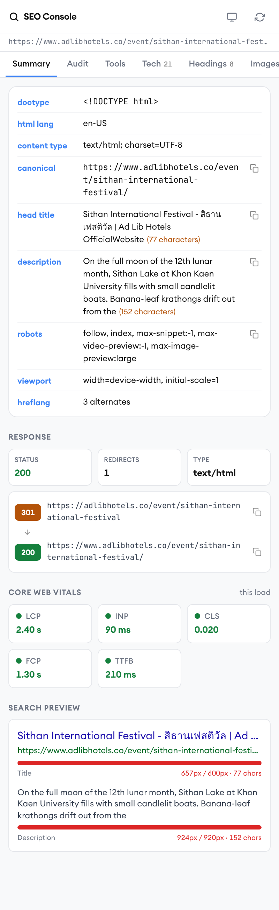
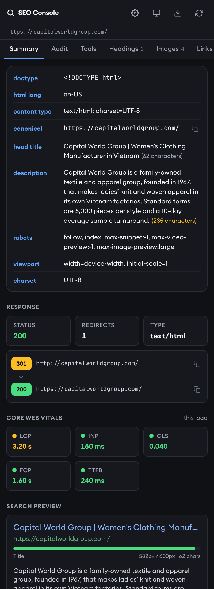
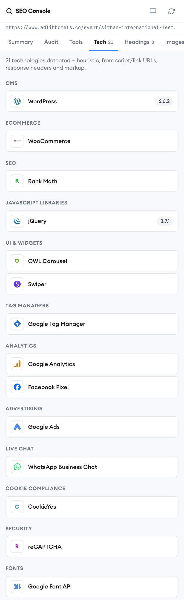
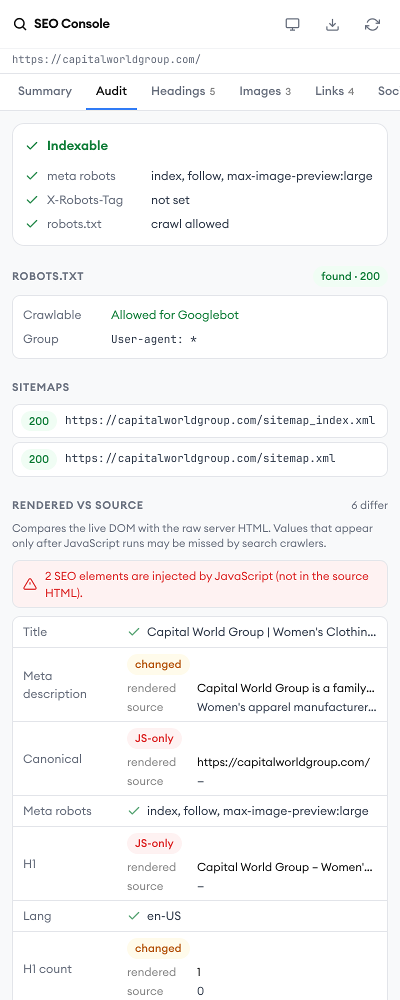
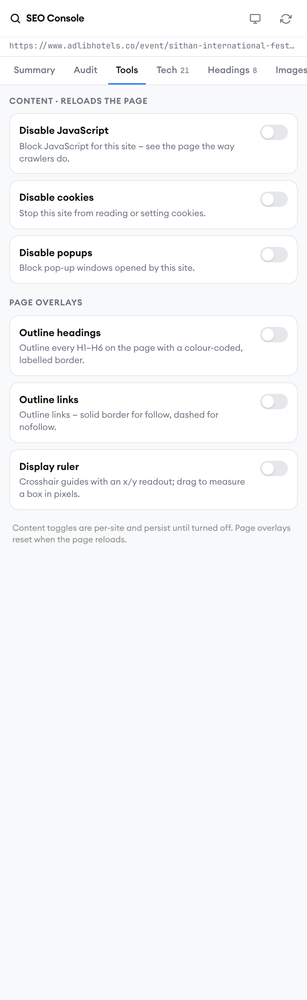

# SEO Console

A Chrome (Manifest V3) extension that inspects on-page SEO for the active tab and
shows everything in a **Side Panel**: HTTP status & redirects, meta tags, a
pixel-accurate SERP preview, heading outline, images, links, Open Graph /
Twitter cards, JSON-LD structured data, an indexability & robots.txt audit, a
rendered-vs-source diff, and a broken-link checker — with a rules engine that
flags issues and lets you click any finding to highlight the element on the page.

Built with **WXT + React + TypeScript + Tailwind CSS v4**, styled with the
**SEO Console design system** (Euclid Circular A, ink-based neutrals, light + dark).

| Light | Dark |
|---|---|
|  |  |

---

## Features

| Area | Details |
|------|---------|
| **HTTP** | Status code (2xx/3xx/4xx/5xx), redirect chain, `X-Robots-Tag`, `Content-Type`. Captured via `chrome.webRequest`; falls back to the Performance API. |
| **Meta** | `title`, `description`, `canonical`, `robots`, `lang`, `charset`, `viewport`, `hreflang`. |
| **SERP preview** | Title/description measured in **pixels** (not characters) against Google's desktop truncation budget — far more accurate for accented text. |
| **Headings** | Full H1–H6 outline, click-to-highlight, with checks for missing/multiple H1, skipped levels, empty headings. |
| **Images** | Missing `alt`, empty `alt` (decorative), missing `width`/`height` (CLS), format, natural size, transfer size, large-image flag. |
| **Links** | Internal vs external, `nofollow`/`sponsored`/`ugc`, empty anchor text, `target="_blank"` without `rel="noopener"`, generic anchors. Filter + counts. |
| **Social** | Open Graph & Twitter Card preview + raw key/values. |
| **Schema** | JSON-LD discovery, type detection, validity, collapsible raw view. |
| **Rules engine** | ~25 rules → issues with severity (error/warning/info), an SEO score, and a highlight target per issue. |
| **Export** | Report (JSON), Issues (CSV), Links (CSV). |
| **Indexability** *(Phase 2)* | A single verdict (Indexable / Blocked) combining `meta robots`, `X-Robots-Tag` and robots.txt, with each signal shown. |
| **robots.txt + sitemaps** *(Phase 2)* | Fetches & evaluates robots.txt for Googlebot (approximate: longest-match, `*`/`$` wildcards), shows the matched rule, and probes sitemap URLs. |
| **Rendered vs source** *(Phase 2)* | Diffs the live DOM against the raw server HTML and flags SEO elements that exist **only after JavaScript runs** (crawlers may miss them). |
| **Broken-link checker** *(Phase 2)* | Checks every link from the background worker (HEAD→GET, 5 concurrent, 8 s timeout, cached). 401/403/405/429 → "unknown" to avoid false positives from WAFs. |
| **Core Web Vitals** *(Phase 3)* | LCP, INP, CLS, FCP, TTFB measured live via `PerformanceObserver`, colour-rated against Google's thresholds (good / needs-improvement / poor). |
| **SPA re-scan** *(Phase 3)* | A `MAIN`-world script patches `history.pushState`/`replaceState` and bridges to the extension via a DOM event, so single-page-app route changes auto re-analyze. |
| **Settings** *(Phase 3)* | Adjustable rule thresholds (title/description pixel budgets, large-image size), saved to `chrome.storage.local`; the page re-scores on save. |
| **Page tools** *(v1.1)* | A Tools tab: toggle **Disable JavaScript** for the site (via `chrome.contentSettings`, reloads the page so you see it as a crawler does) and **Outline headings** (a colour-coded, labelled border on every H1–H6). |
| **Image previews** *(v1.1)* | The Images tab shows an inline thumbnail and the full URL (with copy) of every image. |
| **Technology detection** *(v1.2)* | A Tech tab that fingerprints the page's stack (CMS, frameworks, JS libraries, analytics, ads, CDN, server, WordPress plugins…) from script/link URLs, response headers and markup — grouped by category with versions and bundled brand logos ([Simple Icons](https://simpleicons.org), CC0; no external requests). |
| **Summary copy + sized headings** *(v1.2)* | Copy buttons on canonical/title/description/robots; the Headings outline sizes text by level (H1 largest → H6 smallest). |
| **More page tools** *(v1.3)* | Tools tab adds Disable cookies, Disable popups (content settings), Outline links (solid follow / dashed nofollow) and a Display ruler (crosshair + drag-to-measure). |
| **UI polish** *(v1.3)* | Brand logos for most detected techs; Links show follow (solid) vs nofollow (dashed) borders; Headings wrap long text; Audit values wrap fully with copy buttons; the header is slimmed to theme + hard-reload (Ctrl+Shift+R equivalent). |

The Summary leads with a COMMON overview (doctype, lang, content type, canonical,
title/description with character counts, robots…) and a visual redirect trace with
copy buttons. The Audit tab holds indexability/robots/source-diff; the Tools tab
holds the page toggles:

| Tech | Audit | Tools |
|---|---|---|
|  |  |  |

The extension auto-re-analyzes when you switch tabs or a page finishes loading.

---

## Design & theming

Styled to the **SEO Console brand** (design system in `talabadao/seo-console-official`,
`.claude/skills/seo-console-design`):

- **Typeface:** Euclid Circular A, self-hosted as woff2 (`public/fonts/`, weights
  400/500/600/700, ~135 KB total) and wired via `@font-face` in `style.css`. No
  webfont request at runtime.
- **Tokens, not hex:** brand CSS variables (`--brand-*`, `--sev-*`) are defined once in
  `style.css` and mapped to Tailwind utilities with `@theme inline`, so components use
  semantic classes (`bg-card`, `text-ink`, `border-hairline`, `text-accent`,
  `bg-error-soft`…) and never inline colors.
- **Light + dark:** both are first-class. Default follows the OS (`prefers-color-scheme`);
  a header toggle cycles **system → light → dark** and persists per viewer. Dark uses
  `data-theme="dark"` on `:root`.
- **Data-honesty:** every severity is an **icon + color** (error = red triangle,
  warning = amber circle, notice = blue info), never color alone. The score card follows
  the brand overview pattern: a score, a word (Good / Needs work…), a one-line definition,
  and an Errors / Warnings / Notices summary with bars. Numbers use tabular figures.
- **Ink primary, accent blue for selection only:** one primary action per view; accent
  blue is used for the selected tab, links and focus rings, not as a fill.

---

## Quick start

```bash
npm install        # also runs `wxt prepare`
npm run dev        # launches Chrome with the extension loaded + HMR
```

Then click the toolbar icon to open the side panel.

### Build a production bundle / load unpacked

```bash
npm run build
```

Then in Chrome: **chrome://extensions → enable Developer mode → Load unpacked →**
select `.output/chrome-mv3`.

### Other scripts

```bash
npm run compile    # strict type-check (tsc --noEmit)
npm run zip        # package for the Chrome Web Store
npm run build:firefox
```

---

## Architecture

```
entrypoints/
  background.ts         Service worker: captures main-frame status/redirects/headers
                        via webRequest, keyed by tabId in chrome.storage.session.
  content.ts            Isolated world: runs collectors & Core Web Vitals observers,
                        fetches raw source HTML & robots.txt, highlights elements,
                        relays SPA URL changes.
  history.content.ts    MAIN world: patches history.pushState → DOM event bridge.
  sidepanel/            React UI (Summary, Audit, Headings, Images, Links, Social,
                        Schema) + Settings panel.
    style.css           @font-face, brand tokens (light/dark), @theme inline.
public/fonts/           Euclid Circular A woff2 (self-hosted).
lib/
  collectors/           Pure DOM readers (meta, headings, images, links, schema,
                        social, source, vitals).
  rules/                One file per category; each exports Rule[] (id + evaluate()).
  audit/                Phase 2 pure logic: robots.ts (parse + Googlebot eval),
                        diff.ts (rendered-vs-source), indexability.ts, probe.ts (classify).
  vitals.ts             Core Web Vitals thresholds + ratings (pure).
  settings.ts           User rule thresholds (storage-backed singleton).
  collectors/outline.ts Injects the outline-headings overlay (Tools tab).
  tech/                 v1.2: rules.ts (fingerprint table), detect.ts (engine),
                        types.ts — technology detection.
  report.ts             Merges DOM + HTTP, computes pixel widths, runs rules, scores.
  pixel-width.ts        Canvas-based SERP pixel measurement.
  export.ts             JSON / CSV serializers.
  messaging.ts, types.ts
```

**Data flow:** the side panel asks the content script for a `DomCollection` and
the background worker for the `HttpRecord`, then `buildReport()` merges them,
runs the rules, and renders. The **Audit** tab lazily runs extra work on first
open — the content script fetches the raw source HTML and robots.txt, and the
background worker checks link/sitemap URLs cross-origin (it has the host grant,
so it isn't blocked by CORS). The broken-link checker **streams** each result
back via `runtime.sendMessage`. Collectors, rules and the audit logic are pure
functions over plain objects, so they're trivially testable (see below).

---

## Testing

The project ships with check scripts (in `test/`):

```bash
npm run test:unit    # rules engine + report assembler against a synthetic page
npm run test:audit   # robots.txt matching, link classification, source diff,
                     # indexability, Core Web Vitals ratings
npm run test:tech    # technology detection (scripts/headers/markup, versions, dedupe)
npm run test:e2e     # loads the built extension in Chromium (Playwright) and drives the
                     # live pipeline: webRequest, content collectors, Core Web Vitals,
                     # source fetch, robots.txt, broken-link checker, SPA detection,
                     # outline-headings toggle and technology signals
npm test             # unit + audit + tech + build + e2e, in sequence
```

Current coverage: **15** unit, **32** audit, **22** tech, **43** e2e checks.

> The e2e test launches the **full** Chromium build (`channel: 'chromium'`) —
> Playwright's headless shell can't load extensions. Install it once with
> `npx playwright install chromium`.

---

## Known MV3 caveat (and how it's handled)

An MV3 service worker is torn down when idle. On a **cold start**, the very first
`webRequest` events of a navigation can be delivered before the worker finishes
registering its listeners, so a redirect's `onBeforeRedirect` can occasionally be
missed. SEO Console handles this by **cross-checking the Performance API's
`navigation.redirectCount`** — so "page was redirected" is still reported even
when the detailed hop list isn't captured. Status code has the same fallback
(`PerformanceNavigationTiming.responseStatus`).

The extension can't run on `chrome://` pages, the Chrome Web Store, or PDFs; the
UI shows a clear message in those cases.

---

## Permissions

`activeTab`, `scripting`, `storage`, `sidePanel`, `webRequest`, `tabs`, and
`host_permissions: <all_urls>`.

`<all_urls>` is required for `webRequest` to read status codes/headers and for
the background worker to check cross-origin links. It's declared up front so
**Load unpacked** works instantly. For the Web Store release, consider moving it
to `optional_host_permissions` and requesting it on demand (status still works
via the Performance API fallback, and link checking can be gated behind the
grant).

---

## Roadmap

- **Phase 1 — done:** HTTP/redirects, meta, pixel SERP preview, headings, images,
  links, social, schema, rules engine, export, highlight-on-page.
- **Phase 2 — done:** broken-link checker, robots.txt + indexability, sitemap
  discovery, rendered-vs-source diff (Audit tab).
- **Phase 3 — done:** Core Web Vitals, SPA re-scan on `history.pushState`, a
  settings page for rule thresholds.
- **Phase 4 — done:** multi-page crawl with aggregated reporting (removed in v1.1 as unnecessary).
- **v1.1 — done:** COMMON overview Summary, visual redirect trace with copy buttons,
  image thumbnails, Tools tab (Disable JavaScript, Outline headings).
- **v1.2 — done:** Technology detection tab (Wappalyzer-style), copy buttons on more
  Summary fields, size-by-level heading outline.
- **v1.3 — done:** bundled brand logos, more Tools (disable cookies/popups, outline
  links, ruler), link follow/nofollow borders, wrapping Headings/Audit with copy,
  slimmed header with a cache-bypass hard reload.
- **Deferred (pre-publish):** optional host-permission flow — moving `<all_urls>`
  to `optional_host_permissions` with dynamic content-script registration and an
  `activeTab` fallback. It trades the frictionless multi-tab UX for a smaller
  install warning, and its granted/ungranted paths can't be verified in headless
  Playwright, so it's best done with manual QA at Web Store submission. Chrome's
  native per-site access controls already let users restrict the extension.
- **Phase 5 — ideas:** cross-subdomain crawl (via an offscreen document), scheduled
  exports, saved audits / history.
